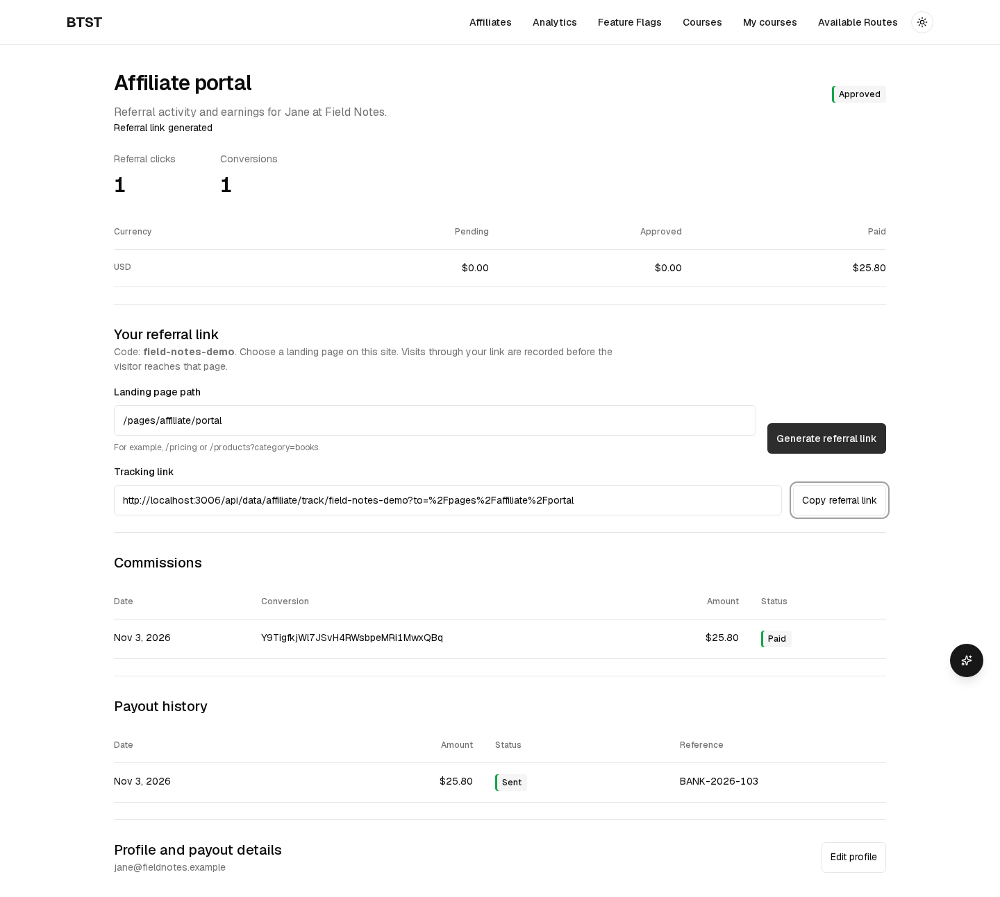
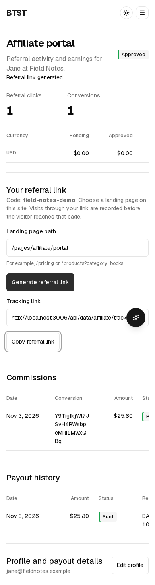
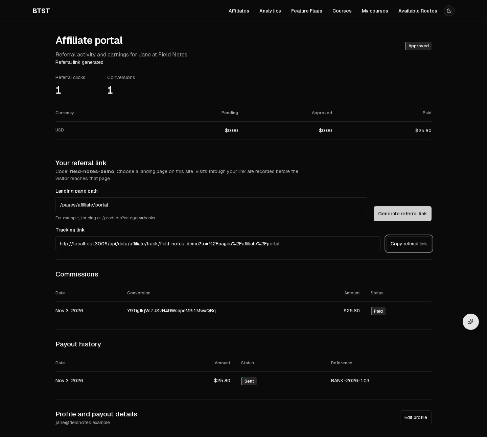

# Affiliate plugin PR evidence

Captured from the generated Next.js application for [PR #305](https://github.com/better-stack-ai/better-stack/pull/305). All partner and payment data is local demonstration data.

[Watch the captioned walkthrough](affiliate-walkthrough.mp4)

The walkthrough covers application, administrator approval, a copied tracking link, cookie attribution, a $129 conversion and $25.80 commission, payout reservation, manual settlement, CSV download, and partner payout history.

The mobile viewport is 390px. Financial tables scroll within their own containers. Keyboard focus is visible in both themes. See findings.json for measured widths and focus styles.

The seven numbered screenshots correspond to the captioned video beats. The storyboard is included for reproduction against a fresh local example server.
